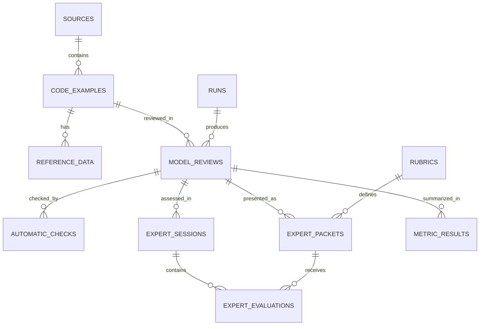

# Данные CCRQS: структура и полный тестовый пример

Дата: 11.11.2026. Версия структуры: `ccrqs-dataset-v1-draft`.

Спецификация описывает исходный код, ответы моделей, экспертную разметку и связанные результаты.

## 1. Материалы

- [Полный читаемый пример](../../contracts/examples/full_example/README.md).
- [Полный пример одним JSON](../../contracts/examples/full_example/dataset.json).
- [Отдельные таблицы примера](../../contracts/examples/full_example/tables/).
- [Существующая схема ответа модели](../../contracts/review_response_v4.schema.json).
- [Инструкция эксперту annotation-v6](../../contracts/protocol/annotation_guideline_v6.md).
- [Пример первичной разметки v6](../../contracts/protocol/expert_annotations_v6.example.json).
- [Шаблон согласия](../../contracts/protocol/expert_consent_v6.md).
- [Пример сохранения невалидного ответа](../../contracts/examples/invalid_model_review.json).

Полный пример содержит один исходник, один модельный ответ, автоматические результаты, четыре ролевых пакета, шесть сессий, двенадцать экспертных ответов, отдельное решение арбитра, журнал публикации и итоговые показатели. Дополнительная таблица содержит семь вымышленных профилей. Все записи — `synthetic: true`; пример — `research_eligible: false`. Времена, модель, результаты тестов и оценки придуманы. Формулы и веса в примере иллюстративны; модель и тесты не запускались.

В проекте диплома также подготовлены 40 технических примеров QuixBugs и связанные эталонные материалы. Снимок можно получить по инструкции в [описании технической выборки](../../data/README.md). Создание фикстуры не означает появления реальных модельных запусков или участия экспертов.

## 2. Единицы и связи

**Пример кода** — неизменяемая версия исходников и разрешённого контекста. **Объект экспертной оценки** — конкретный ответ модели на этот пример. **Сессия** — работа одного эксперта с этим ответом. **Первичный ответ эксперта** — отдельная ролевая запись внутри сессии, привязанная к предъявленному пакету и схеме оценки.

| Сущность | Ключ | Связи и содержимое |
|---|---|---|
| `sources` | `source_id` | Корпус, URL, ревизия/выпуск, лицензия, хеши снимка |
| `code_examples` | `example_id` | `source_id`, исходный ID, язык, группа репозитория/дубликатов, split, исходные файлы `{path, content, sha256}`, разрешённый контекст |
| `reference_data` | `reference_id` | `example_id`, версия эталона, исправленные файлы, тесты, ожидаемое поведение, описание основного дефекта и состояние его проверки |
| `runs` | `run_id` | `producer_id`, модель/ревизия, backend, prompt, параметры, seed, окружение, версия конвейера, время |
| `model_reviews` | `review_id` | `example_id`, `run_id`, `producer_id`, `external_result_id`, номер попытки, точный запрос, сырой и структурированный ответ, ошибки, происхождение, статус публикации |
| `automatic_checks` | `check_id` | `review_id`, `issue_index`, `reference_id`, окружение, профиль, A/T/R, исходы тестов, журналы и время |
| `rubrics` | `rubric_version` | Неизменяемая форма/правила, ссылка на инструкцию, статус и хеш определения |
| `expert_packets` | `packet_id` + версия | `review_id`, `reference_id`, `rubric_version`, роль, индекс замечания, снимок предъявленных материалов и хеш |
| `expert_sessions` | `session_id` | `expert_id`, `review_id`, `rubric_version`, назначенные роли и состояние сохранения |
| `assignments` | `assignment_id` | `session_id`, эксперт, пакет/версия, время выдачи/предъявления/завершения и состояние |
| `expert_evaluations` | `evaluation_id` | Сессия, review, эксперт, назначение, пакет/версия, схема оценки, роль, значения формы, обоснование, содержательный статус, длительность и время |
| `adjudications` | `adjudication_id` | Review, спорное замечание, исходные оценки, арбитр, решение, причина и время |
| `publication_events` | `event_id` | Review, актор, предыдущий/следующий статус, причина и время |
| `metric_results` | `metric_result_id` | Review, конфигурация/версия расчёта, схема оценки, ID проверок/оценок/арбитража, показатели и полнота |

Один пример связан с любым числом ответов разных моделей/повторов. Каждый ответ связан ровно с одним примером и прогоном; его публикация учитывается отдельно. Один ответ может иметь сессии разных экспертов и несколько проверок/расчётов. Внешние ID и внутренние связи сохраняются при экспорте.

Уточнение к исходной общей спецификации: уникальность `(expert_id, response_id)` относится к сессии; в файловом формате `response_id` называется `review_id`. Несколько дочерних ответов M/C/S не считаются дублирующими сессиями. Версии пакетов и события замены сохраняют историю. Это проектное требование: ограничения PostgreSQL предстоит реализовать в задачах #24, #25 и #30.

Область внешнего ключа результата в структуре — `(producer_id, external_result_id)`. Это ещё не полный контракт идемпотентности API: точный перечень полей идентичности и сравнения повторов остаётся в #7/#34, а реализация — в #54–#57.

## 3. Совместимость ответа модели

Обёртка датасета использует `schema_version: "ccrqs-dataset-v1-draft"`. Вложенный `model_reviews[].structured_response` использует **собственную** существующую версию `schema_version: "1.0"` и массив `issues`. Эти версии обозначают разные уровни и не подменяют друг друга.

Каждое замечание сохраняет поля схемы без переименования: `file`, `line_start`, `line_end`, `category`, `severity`, `comment`, `proposed_patch`, `confidence`. `issue_index` — внешний индекс с 0; он не добавляется внутрь замечания, поскольку схема запрещает дополнительные свойства. Порядок замечаний сохраняется.

Проверка JSON по схеме проверяет форму. Она не подтверждает истинность комментария, безопасность patch, допустимость путей в конкретном примере или качество модели. Сопоставление с исходником и семантическая оценка выполняются отдельно.

Структура датасета и пример полного экспорта не объявляются пакетом HTTP-импорта. Версия и форма такого пакета, поэлементный ответ, маршруты, лимиты и сервисная аутентификация остаются в #6, #31–#36 и #39.

## 4. Сырой ответ, разбор и ошибки

Исходный ответ сохраняется всегда в `raw_response` с `raw_response_sha256`, даже при ошибке JSON или схемы. Разбор не меняет оригинал; результат извлечения хранится отдельно в `structured_response`. Сохраняются `parse_status`, `validation_errors`, версия/метод извлечения, сведения о ручном вмешательстве и статус генерации.

| Случай | Сырой ответ | Структурированный ответ | Отдельно учитывается |
|---|---|---|---|
| JSON соответствует схеме | Точный текст | Валидный объект | `parse_status=schema_valid` |
| JSON разбирается, но схема нарушена | Точный текст | Полученный объект как невалидные данные | `parse_status=schema_invalid`, ошибки схемы; объект не считается валидным review |
| JSON повреждён/не извлечён | Точный текст | `null` | `parse_status=invalid_json`, ошибки разбора |
| Генерация прервана | Имеющийся частичный текст или пустая строка | Только если удалось извлечь объект; иначе `null` | `generation_status=timeout/error`; частичный вывод не считается успешной генерацией |
| Валидный `issues: []` | Точный текст | Валидный объект с пустым массивом | Успешный разбор; это не отсутствие ответа и не сбой инфраструктуры |

Ручное извлечение/исправление формы создаёт отдельную производную запись/версию с автором, причиной и ссылкой на оригинал. Исходные код и ответ не перезаписываются. Семантически неизвестное значение не заменяется нулём. Реальный обработчик API и запись в БД в эту документационную работу не входят.

## 5. Статусы и история

| Сущность | Статус | Значение |
|---|---|---|
| Ответ модели | `pending_review` | Принят, ждёт отдельной административной проверки |
| Ответ модели | `published` | Разрешён к выдаче экспертам |
| Ответ модели | `rejected` | Отклонён с обязательной причиной; в выдачу не попадает |
| Ответ модели | `withdrawn` | Снят с публикации с обязательной причиной; новые задания и отправки заблокированы |
| Сессия/ответ эксперта | `draft` | Изменяемый черновик по закреплённой версии схемы оценки |
| Сессия/ответ эксперта | `submitted` | Отправленная неизменяемая запись |

Переходы review: `pending_review → published/rejected`, `published → withdrawn`. Остальные переходы, включая повторную публикацию снятого review, не поддерживаются по умолчанию. Исправление исходного содержимого — новая загрузка, а не редактирование опубликованного оригинала. В `publication_events` сохраняются актор, время, переход и причина.

Содержательные исходы экспертной оценки `completed`, `abstained`, `data_problem` хранятся отдельно от `draft/submitted`: пропуск или проблема данных не являются оценкой 0. Снятие review сохраняет первичные ответы и черновики, но блокирует дальнейшую работу/отправку по нему. Изменение схемы оценки не переводит старый черновик на новую форму.

Это описание поведения. Конкурентное применение переходов, запрет изменения и управление черновиками остаются задачами реализации.

## 6. Инструкция и версия схемы оценки

Проектная инструкция `annotation-v6` и учебная форма полного примера `rubric-demo-full-v1` различаются. Статус первой — проект протокола; второй — `synthetic_demo_only`, не утверждённая исследовательская шкала.

В реестре схем оценки предусматриваются `rubric_version`, неизменяемое определение, хеш, инструкция и её версия/хеш. Пакет, сессия, назначение и первичный ответ сохраняют использованную версию. Старые определения и инструкции остаются доступными для чтения прежних ответов и продолжения черновиков. Полный формат поставляемой формы, активная версия и реализация реестра остаются в #69–#73.

Инструкция описывает роли M/C/S/H, шкалы и якоря, маскирование модели и чужих ответов, самостоятельность, пропуски, проблемы данных, порядок предъявления, арбитраж и передачу ответа. Формат первичного ответа включает пакет/версию, назначение, эксперта, роль, индекс замечания, значения формы, обоснование, длительность и содержательный статус.

H отделена от M/C/S по одному исходному примеру, включая ответы других моделей. При совмещении M/C/S комментарий оценивается до открытия patch. C назначается после итогового сопоставления M; S — при A=T=1. Для разных ролей формируются отдельные снимки разрешённых материалов, а не выдаётся полный исследовательский JSON.

Шаблон согласия содержит незаполненные организационные условия; его наличие не означает согласие реального участника или готовность к набору. Утверждение схемы оценки и анкеты остаётся в #2/#4.

## 7. Хранение вложенных данных

Проектное отображение на PostgreSQL: идентификаторы, внешние ключи, статусы, версии и время — типизированные колонки; вложенные формы и результаты — JSONB. Предусмотрены следующие группы JSONB:

| Таблица | Вложенные данные | Проверка версии |
|---|---|---|
| `code_examples` | `source_files`, `allowed_context` | Версия структуры датасета, пути и SHA-256 |
| `reference_data` | Эталонные файлы, тесты, дефект, ожидаемое поведение | Версия эталонных материалов |
| `runs` | Параметры генерации, окружение, метаданные | Версия метаданных прогона; обязательность ещё требует согласования |
| `model_reviews` | Разобранный объект, ошибки и происхождение извлечения | Схема ответа модели `1.0`; невалидный объект маркируется отдельно |
| `automatic_checks` | Исходы тестов, диагностика, окружение | Версия профиля проверки |
| `rubrics` | Определение формы и правила проверки | Неизменяемая `rubric_version` |
| `expert_packets` | Снимок предъявленных материалов | Версия пакета и схемы оценки |
| `expert_evaluations` | `ratings`, сведения о проблеме данных | Закреплённая версия схемы оценки |
| `adjudications`, `metric_results` | Решение/основания, конфигурация, значения показателей | Версия арбитража/расчёта и схема оценки |

Точный сырой текст ответа хранится как текст, а не восстанавливается сериализацией JSONB. Версии не определяются по текущей форме UI. Новый релиз не валидирует старые ответы по новой схеме оценки и не приводит автоматически разные шкалы. Это завершает проектирование размещения вложенных данных; DDL, миграции и валидаторы приложения остаются в #24, #30, #39, #70, #88.

## 8. Граница готовности

Подготовлены описание сущностей/связей/статусов, инструкция с привязкой к версии, правила сохранения сырого и невалидного ответа, совместимость вложенного review с существующей схемой и полный синтетический пример. Они доступны разработчику в этом репозитории.

Не выполнены этой работой: утверждение исследовательских шкал, получение реальных модельных/экспертных данных, окончательный HTTP-контракт, схема пользователей/прав/анкеты, PostgreSQL/Alembic, API, UI, реестр схем оценки, механизм экспорта и развёртывание. Файловый пример выгрузки не является экспортом из работающего сервиса.
