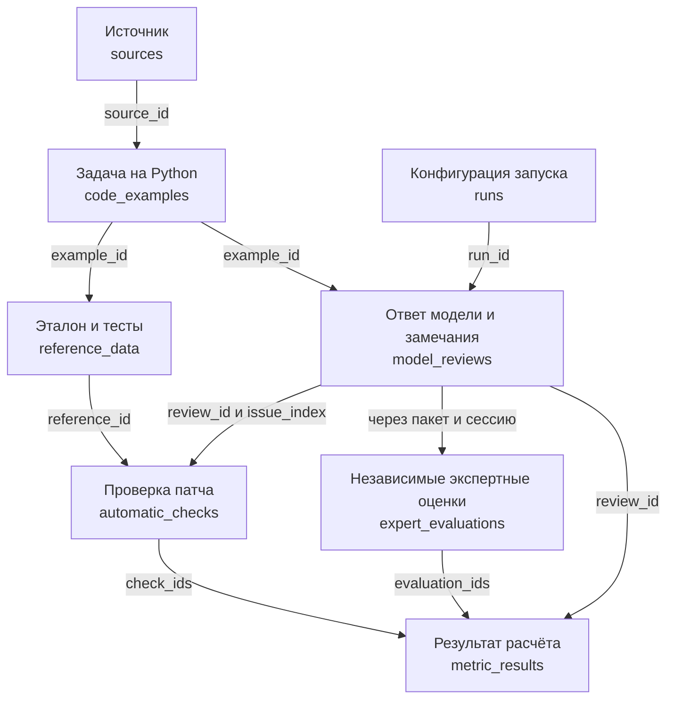

# Структура датасета CCRQS

Рисунок — Связи основных таблиц датасета CCRQS. Для расчёта CCRQS используются результаты проверки патчей и экспертные оценки по ролям M, C и S. Независимая целостная оценка H сохраняется для проверки согласованности с CCRQS.
