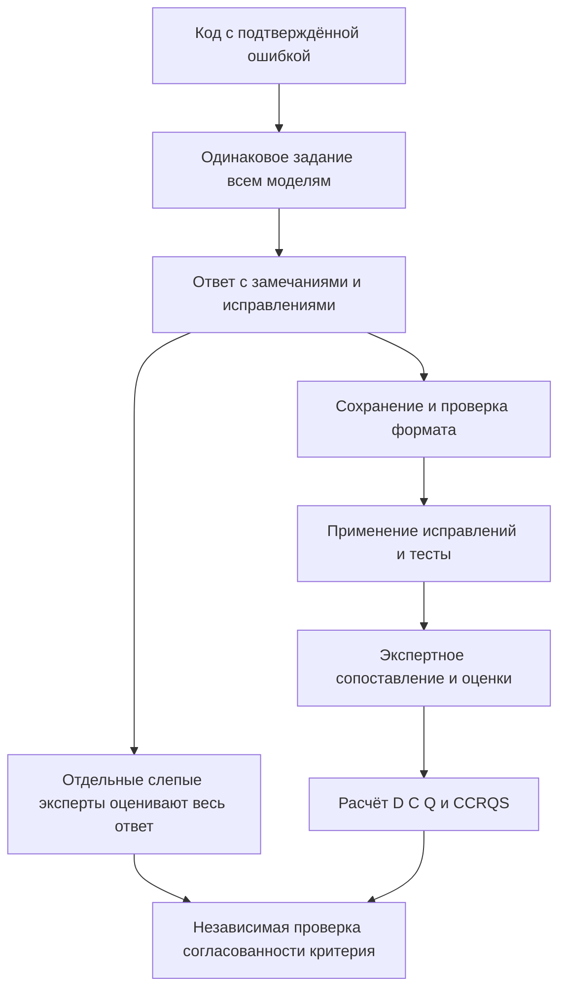

# Пошаговый пример работы пайплайна CCRQS

Материал для показа научному руководителю. На одной маленькой функции показано, как из ответа модели получается оценка качества code review: обнаружение дефекта **D**, качество комментария **C** и качество исправления **Q**.

**Статус примера.** Это учебная демонстрация. Ответы A–D подготовлены специально для объяснения, LLM не запускались. Оценки экспертов также учебные. Применение исправлений, проверка синтаксиса, выполнение четырёх проверочных случаев и арифметика метрик действительно проверены в Python 3.12.14. Пример не включается в исследовательскую выборку и не подтверждает гипотезу о валидности CCRQS.

## Вся идея за полминуты

Представим, что модель — разработчик, которому дали код на ревью. У проверяющего заранее есть описание ошибки и тесты, но модель их не видит. Модель возвращает замечание и исправление. Затем мы проверяем три вещи: она нашла нужную ошибку, объяснила её понятным образом и предложила исправление, которое сохраняет правильное поведение программы.



## Шаг 1 Берём код с одной понятной ошибкой

Файл `average.py`:

```python
def average(values):
    """Среднее списка чисел; для пустого списка вернуть None."""
    return sum(values) / len(values)
```

Ожидаемое поведение закреплено в описании функции: для пустого списка нужно вернуть `None`. Это выбранный контракт учебного примера, а не универсальное правило для функций вычисления среднего.

При `average([2, 4])` получаем `3.0`. При `average([])` делим ноль на ноль и получаем `ZeroDivisionError`. Основной подтверждённый дефект — отсутствие обработки пустого списка в строке 3.

**Как объяснить:** «Даю модели короткую функцию, в которой точно есть одна ошибка. Правильное поведение определено заранее».

## Шаг 2 Проверяем сам пример до запуска модели

Готовим целевую проверку, которая воспроизводит ошибку, и проверки уже работающего поведения. Затем убеждаемся, что эталонное исправление проходит их все.

| Проверка | Вход | Ожидаемое значение | Исходный код | Эталонное исправление |
|---|---|---|---|---|
| Целевая `empty` | `[]` | `None` | Ошибка деления на ноль | Проходит |
| Регрессионная `positive` | `[2, 4]` | `3.0` | Проходит | Проходит |
| Регрессионная `zero` | `[0]` | `0.0` | Проходит | Проходит |
| Регрессионная `balanced` | `[-2, 2]` | `0.0` | Проходит | Проходит |

Эталонная версия добавляет перед делением:

```python
    if not values:
        return None
```

Все эти исходы проверены выполнением кода. В настоящем корпусе пример без воспроизводимого отказа, работающего эталона или регрессионных тестов не допускается к полному CCRQS по основному протоколу.

**Как объяснить:** «Сначала проверяю собственную контрольную задачу. Иначе я могу обвинить модель в ошибке, которая на самом деле находится в тестах или эталоне».

## Шаг 3 Отделяем вход модели от материалов проверяющего

Модель получает исходный код, нейтральное описание ожидаемого поведения и одинаковую инструкцию на ревью. Эталонное объяснение причины, исправленная версия и скрытые тесты остаются у проверяющего.

| Получает модель | Остаётся у проверяющего |
|---|---|
| Дефектный `average.py` | Эталонное описание дефекта |
| Контракт поведения функции | Эталонное исправление |
| Единая инструкция и формат JSON | Целевые и регрессионные тесты |
| Допустимый контекст Python-проекта | Экспертные оценки и метрики |

Смысл инструкции: найти функциональные ошибки, ошибки выполнения и подтверждаемые проблемы безопасности; для каждой дать место, объяснение, unified diff и уверенность. Замечания только о стиле не запрашиваются. Ответ должен соответствовать версии схемы `1.0`.

В настоящем запуске все модели получают одно содержательное задание и одинаковые ограничения контекста. Сохраняются точные версии весов, настройки, шаблоны диалога, время и ресурсы. В этой демонстрации этап генерации заменён заранее подготовленными ответами.

**Как объяснить:** «Задание у всех одинаковое. Подсказку с готовым ответом модель не получает».

## Шаг 4 Получаем структурированный ответ

Учебный ответ A:

```json
{
  "schema_version": "1.0",
  "issues": [
    {
      "file": "average.py",
      "line_start": 3,
      "line_end": 3,
      "category": "runtime",
      "severity": "medium",
      "comment": "В строке 3 при values=[] длина списка равна нулю, поэтому возникает ZeroDivisionError вместо предусмотренного None. До деления добавьте проверку if not values и возврат None; для непустого списка сохраните вычисление среднего.",
      "proposed_patch": "--- a/average.py\n+++ b/average.py\n@@ -1,3 +1,5 @@\n def average(values):\n     \"\"\"Среднее списка чисел; для пустого списка вернуть None.\"\"\"\n+    if not values:\n+        return None\n     return sum(values) / len(values)\n",
      "confidence": 0.9
    }
  ]
}
```

JSON нужен, чтобы одинаково разобрать ответы всех моделей. Порядок замечаний сохраняется: для C и Q будет использовано первое замечание, сопоставленное с основным дефектом. Самооценка уверенности и серьёзности сохраняется, но в базовую формулу CCRQS не входит.

**Как объяснить:** «Прошу ответить по одной анкете: где ошибка, почему она возникает и как её исправить».

## Шаг 5 Сохраняем ответ и проверяем его форму

Сначала сохраняется исходный текст, затем проверяются JSON, обязательные поля, допустимые категории, путь к файлу и номера строк. Исправление должно менять только разрешённый исходный файл; подменять тесты нельзя.

Ответы A–D в демонстрации прошли существующую JSON Schema проекта. Для предложенных diff проверены точное совпадение исходного текста и синтаксис полученного Python-кода.

Корректный формат ещё не означает правильный ответ: ошибочное замечание может быть оформлено идеальным JSON. В основном пайплайне повреждённый ответ сохраняется и передаётся на извлечение явно присутствующих замечаний по протоколу; модель не получает дополнительную попытку «переписать ответ получше».

**Как объяснить:** «Сначала проверяю, что ответ можно обработать. Потом отдельно проверяю его содержание».

## Шаг 6 Проверяем что модель действительно нашла

Для сопоставления с эталонным дефектом в исследовании используются три независимых эксперта M. Они видят код, эталонное описание и комментарии, но не название модели и не её исправление. При расхождении требуется отдельный арбитр.

Для объяснения подготовлены четыре варианта ответа:

| Ответ | Содержание | Учебный результат сопоставления |
|---|---|---|
| A | Точно описывает деление на ноль и даёт корректный diff | Одно истинное обнаружение |
| B | Находит деление на ноль, даёт ошибочный diff и добавляет ложное утверждение о целочисленном делении оператором `/` в Python 3 | Одно истинное и одно ложное замечание |
| C | Содержит тот же правильный комментарий, что A, но `proposed_patch: null` | Одно истинное обнаружение |
| D | `{"schema_version":"1.0","issues":[]}` | Основной дефект пропущен |

Совпадения только номера строки недостаточно. Проверяем, описаны ли нужная причина и поведение. Дополнительный реально подтверждённый дефект вне эталона учитывается отдельно как `additional_valid`, а не автоматически объявляется ложным. В ответе B дополнительное утверждение неверно: `/` не выполняет целочисленное деление в Python 3.

Обозначения: TP — верное обнаружение, FP — ложное или повторное замечание, FN — пропущенный основной дефект.

`D = 2 × TP / (2 × TP + FP + FN)`

| Ответ | TP | FP | FN | D |
|---|---:|---:|---:|---:|
| A | 1 | 0 | 0 | 1 |
| B | 1 | 1 | 0 | 2/3 |
| C | 1 | 0 | 0 | 1 |
| D | 0 | 0 | 1 | 0 |

**Как объяснить:** «За найденную ошибку даём зачёт, за лишние ошибочные замечания снижаем балл. Длинный список претензий сам по себе не делает ревью лучше».

## Шаг 7 Оцениваем качество комментария

Три эксперта C оценивают только первый сопоставленный комментарий, не видя patch. Каждый выставляет по 0–2 балла за конкретность, правильность объяснения и полезность предлагаемого действия. По каждому признаку берётся медиана трёх оценок, затем сумма делится на 6.

Для A и C учебные оценки трёх экспертов: `(2, 2, 2)`, `(2, 2, 2)`, `(2, 2, 1)`. Медианы по признакам — `(2, 2, 2)`.

`C_A = C_C = (2 + 2 + 2) / 6 = 1`

В B комментарий: «В строке 3 при values=[] len(values)=0, поэтому возникает ZeroDivisionError. Добавьте отдельную ветку для пустого списка». Указаны место и причина, но не сказано, что ветка должна возвращать `None`. Учебные оценки: `(2, 2, 1)`, `(2, 2, 1)`, `(2, 1, 1)`. Медианы — `(2, 2, 1)`.

`C_B = (2 + 2 + 1) / 6 = 5/6 ≈ 0.833`

В D нет сопоставленного комментария, поэтому `C_D = 0` по правилу протокола. Все приведённые оценки придуманы для демонстрации схемы оценки.

**Как объяснить:** «Проверяю, сможет ли разработчик по этому тексту понять причину и выполнить нужное действие. Красивый patch не должен повышать балл слабого комментария».

## Шаг 8 Проверяем исправление на выполнении кода

Каждый patch проверяется отдельно на исходной дефектной версии. Для A получаем:

```python
def average(values):
    """Среднее списка чисел; для пустого списка вернуть None."""
    if not values:
        return None
    return sum(values) / len(values)
```

В B подготовлено ошибочное исправление:

```python
def average(values):
    """Среднее списка чисел; для пустого списка вернуть None."""
    if not sum(values):
        return None
    return sum(values) / len(values)
```

Оно устраняет деление на ноль для пустого списка, но путает пустой список с непустым списком, сумма которого равна нулю. На `[0]` и `[-2, 2]` возвращает `None` вместо `0.0`.

| Автоматическая проверка | Patch A | Patch B |
|---|---|---|
| Применился и синтаксически корректен | Да, A=1 | Да, A=1 |
| Целевой случай `[]` | Проходит, T=1 | Проходит, T=1 |
| Регрессионный случай `[2, 4]` | Проходит | Проходит |
| Регрессионный случай `[0]` | Проходит | Не проходит |
| Регрессионный случай `[-2, 2]` | Проходит | Не проходит |
| Сохранённые регрессионные случаи | 3 из 3, R=1 | 1 из 3, R=1/3 |

Эта таблица получена выполнением кода. В исследовательском фреймворке patch запускаются в закреплённом изолированном окружении. Здесь выполнена небольшая доверенная учебная фикстура; это не повторная проверка Docker-пайплайна.

После тестов эксперты S оценивают смысл исправления по шкале `0 / 0.5 / 1`, не видя результатов этих тестов и эталонного patch. Для A учебные оценки `(1, 1, 1)`, медиана `S=1`. Для B — `(0, 0, 0.5)`, медиана `S=0`.

`Q = A × T × R × S`

`Q_A = 1 × 1 × 1 × 1 = 1`

`Q_B = 1 × 1 × 1/3 × 0 = 0`

Для C исправление отсутствует, поэтому `Q_C=0`. Для D нет сопоставленного замечания, поэтому `Q_D=0`.

**Состояние до разметки.** После автоматических тестов для A и B уже известны A/T/R, но S и итоговый Q ещё неизвестны. Пайплайн хранит их как `null` до экспертной оценки. При отсутствии patch или при A=0 либо T=0 соответствующий Q равен формальному нулю. Сбой окружения и отсутствующая оценка эксперта нулём не заменяются.

**Как объяснить:** «Проверяю не только исчезновение исходной ошибки, но и сохранение уже работающих случаев. Затем человек проверяет смысл исправления: даже все зелёные тесты могут оказаться неполными».

## Шаг 9 Получаем единый балл CCRQS

Для пилота в v8 закреплены равные веса. В учебном примере используем их же:

`CCRQS = (D + C + Q) / 3`

| Ответ | D | C | Q | Учебный CCRQS |
|---|---:|---:|---:|---:|
| A — полный корректный ответ | 1 | 1 | 1 | **1.000** |
| B — верное обнаружение, ложное замечание и неверный patch | 2/3 | 5/6 | 0 | **0.500** |
| C — верный комментарий без patch | 1 | 1 | 0 | **0.667** |
| D — пустой ответ | 0 | 0 | 0 | **0.000** |

Для B: `(2/3 + 5/6 + 0) / 3 = 0.5`.

Из A и C видно, зачем нужен Q: оба правильно нашли и объяснили ошибку, но только A содержит проверяемое исправление. Из A и B видно, зачем D учитывает ложные срабатывания, а Q — регрессии и смысл patch.

Это баллы отдельных ответов на один пример. Они не являются рейтингом реальных моделей или оценкой их среднего качества. Пороги «хорошо» и «отлично» здесь не устанавливаются. CCRQS=1 на этом примере означает максимум по заданной схеме оценки, а не доказательство правильности на всех возможных входах.

**Как объяснить:** «Собираю три уже нормированных показателя в один прозрачный балл. Всегда могу показать, из-за какой части он снизился».

## Шаг 10 Проверяем сам критерий независимыми оценками

Для H работают три других эксперта: для этого экземпляра они не участвуют в M/C/S ни по одному ответу. Им показываются исходный код, нейтральная спецификация поведения и содержательное ревью целиком. Название модели, confidence/severity, эталонное исправление, тестовые исходы и значения метрик скрыты.

Они ставят общую оценку полезности review от 0 до 4. В учебной иллюстрации:

| Ответ | Три учебные оценки H | Медиана H |
|---|---|---:|
| A | 4, 4, 3 | 4 |
| B | 1, 1, 2 | 1 |
| C | 2, 2, 3 | 2 |
| D | 0, 0, 0 | 0 |

H не вычисляется из CCRQS. Совпадение порядка этих четырёх специально подготовленных ответов показывает идею сравнения, но не валидирует критерий.

В реальном исследовании после технической отладки проводится пилот на 20–30 примерах с 3–4 локальными моделями. Затем основной корпус делится по независимым группам репозиториев на калибровочную и тестовую части. Веса подбираются только на калибровочной части, фиксируются и применяются к тестовой части без новой настройки. На тестовых ответах проверяется корреляция Спирмена между CCRQS и H с 95%-м доверительным интервалом. Уровень ρ≥0.75 — проверяемая гипотеза.

**Как объяснить:** «Мало придумать формулу. Надо проверить, согласуется ли она с оценками других разработчиков на новых данных».

## Что показать на встрече за пять минут

1. **Одна минута:** исходная функция и таблица тестов из шагов 1–2. Показать, что ошибка реальна и эталон работает.
2. **Одна минута:** разделение данных из шага 3 и ответ A. Объяснить одинаковое задание и скрытый эталон.
3. **Одна минута:** исправление B и его два регрессионных отказа. Это самый наглядный момент: ошибка исчезла, но программа стала неверно работать на других входах.
4. **Одна минута:** таблица D/C/Q/CCRQS из шага 9. Сравнить A с C, затем A с B.
5. **Одна минута:** отдельная группа H и независимая тестовая проверка. Чётко обозначить, какие данные ещё нужно получить в исследовании.

Короткий текст для объяснения:

> Я исследую качество полного ответа модели на code review. Беру Python-код с подтверждённой ошибкой и рабочим эталонным исправлением. Модель видит только исходный код, контекст и общую инструкцию. В ответе она должна назвать проблему, объяснить её и предложить patch.
>
> На этом примере ошибка — деление на ноль при пустом списке. Хороший ответ её находит, объясняет и добавляет правильную проверку. Другой ответ тоже находит ошибку, но исправляет её через сумму элементов. Пустой список начинает работать, зато списки с нулевой суммой ломаются. Поэтому одного обнаружения ошибки недостаточно.
>
> Я отдельно оцениваю обнаружение D, комментарий C и исправление Q. Для пилота беру равные веса. Затем проверяю, соответствует ли полученный CCRQS общей оценке других экспертов, которые не видели мои метрики. Веса настраиваются на калибровочной части, а проверяются на независимой тестовой. Здесь показана учебная механика; реальные оценки моделей и экспертов ещё нужно собрать.

## Что сохранено вместе с примером

`responses/A.json` — `responses/D.json` содержат подготовленные ответы в формате проекта. `Проверка примера.json` содержит исходные и эталонные тестовые исходы, результаты patch, учебную разметку и рассчитанные баллы. В нём явно записано, что ответы и оценки синтетические и что реальная LLM не вызывалась. `demo.py` позволяет повторить эту небольшую проверку из корня репозитория:

```sh
python examples/average/demo.py
```

Автоматизированная часть этого примера проверяет подготовленные ответы и код. Значения M/C/S/H заданы как учебные входные данные, а не получены автоматической «экспертной» оценкой. Статические анализаторы в этой демонстрации не запускались; по v8 им в исследовании назначаются показатели обнаружения в области правил, а не полный CCRQS.